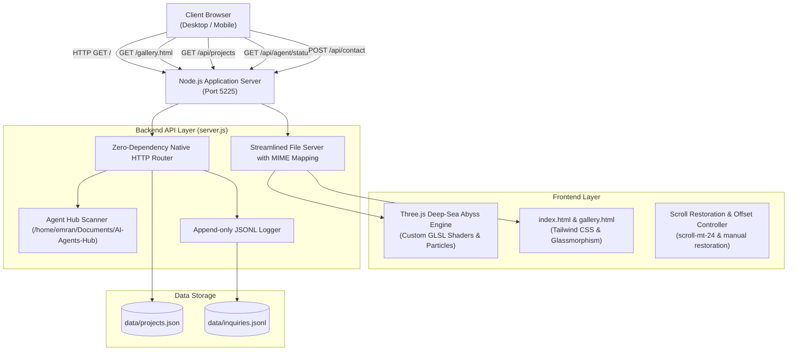

# System Architecture: Emran Hosen Portfolio

## Pinned Core Dependencies & Technologies
- **Runtime**: Node.js v22+
- **Styling**: Tailwind CSS CDN, Montserrat & Inter Fonts
- **3D Graphics**: Three.js r128 (Procedural caustics, floating particles, caustics waves)
- **APIs**: Native Node.js `http`, `fs`, `path`, `url` (Zero npm vulnerabilities)
- **Data Stores**: Flat JSON (`data/projects.json`) & Append-only JSONL (`data/inquiries.jsonl`)
