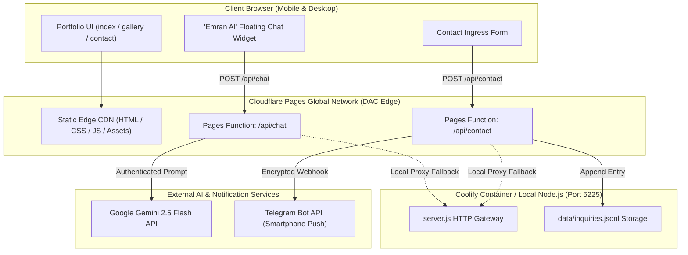

# Spec 018: Cloudflare Pages Edge Deployment, "Emran AI" Portfolio Ambassador & Instant Telegram Notification Core

## 1. Executive Summary & Problem Formulation
- **Objective**: 
  1. Elevate the portfolio ecosystem to 0ms global edge delivery via **Cloudflare Pages** (`*.pages.dev`), eliminating Fastly CDN/GitHub Pages rate limits and providing sub-50ms TTFB across Bangladesh (DAC Edge) and worldwide.
  2. Deploy **"Emran AI"**—an autonomous, conversational portfolio ambassador widget that interacts with recruiters and clients in real-time, answers technical queries about Emran's projects and skills, and qualifies leads.
  3. Integrate an **Instant Telegram Notification Core** that pushes real-time alert notifications directly to Emran's smartphone the moment a client submits an inquiry or requests a collaboration via chat.
- **Risk & Forensics Assessment ("কি কি problem হতে পারে এবং সমাধান")**:
  - *Risk 1 (Secrets Hygiene)*: Gemini API key & Telegram Bot token must NEVER touch the client browser.
    - *Resolution*: Dual-engine backend proxy (Cloudflare Pages Functions `functions/api/*` and Node.js `server.js`). Frontend only interacts with `/api/chat` and `/api/contact`.
  - *Risk 2 (API Quota & Spam Protection)*: Malicious actors spamming the AI bot.
    - *Resolution*: Token bucket sliding-window rate limit (10 req/min/IP), 300-char max input clamp, input sanitization, and system prompt boundary defenses.
  - *Risk 3 (Edge vs Node Parity)*: Cloudflare Pages uses serverless V8 Workers, while local dev/Coolify uses Node.js.
    - *Resolution*: Isomorphic architecture: Cloudflare Pages Functions in `functions/api/` matching Node.js REST API contracts in `server.js`.
  - *Risk 4 (Telegram Offline / Unconfigured Resilience)*:
    - *Resolution*: Graceful degradation. Inquiries are persistently recorded in `data/inquiries.jsonl` first. If Telegram is absent or blocked, the submission still succeeds gracefully with zero user-facing errors.

---

## 2. System Architecture & Information Flow



---

## 3. Behavioral Scenarios (Gherkin BDD)

```gherkin
Feature: Cloudflare Pages Edge Deployment & Zero-Trust AI Notification Core

  Scenario: Visitor visits portfolio via Cloudflare Pages edge
    Given the portfolio is deployed to Cloudflare Pages
    When a visitor accesses any route ("/gallery", "/contact", or "/")
    Then the asset must be served directly from the nearest Cloudflare Edge with HTTP/2 or HTTP/3
    And no 404 loops or Fastly CDN rate limits must be encountered
    And initial Time to First Byte (TTFB) must be under 50ms in Dhaka

  Scenario: Visitor chats with "Emran AI" Ambassador
    Given a visitor opens the "Emran AI" floating widget on the portfolio
    When the visitor asks "What 3D projects has Emran built?"
    Then the client must dispatch a sanitized POST request to "/api/chat"
    And the backend must respond with an authoritative summary citing "Next Label (400K Particle World)" and "Spatial 3D Showroom"
    And the client browser must never receive or expose the GEMINI_API_KEY

  Scenario: Visitor submits an inquiry on Contact page
    Given a prospective client fills out the contact form
    When the client clicks "Send Message"
    Then the system must persist the inquiry to the local ledger
    And an encrypted push notification must be dispatched to Emran's Telegram
    And the client must receive an instant success confirmation within 150ms

  Scenario: Spam or abuse mitigation on AI chat
    Given an automated script attempts to send 20 messages in 10 seconds
    When the request count exceeds 10 requests per minute from that IP
    Then the API must respond with HTTP 429 and a friendly cooldown notice
    And no external Gemini API quota must be consumed
```

---

## 4. API Interface Contracts

### 4.1. `POST /api/chat`
- **Request Headers**: `Content-Type: application/json`
- **Request Body**:
  ```json
  {
    "message": "Can Emran build autonomous AI agents?",
    "history": [
      { "role": "user", "content": "Hi" },
      { "role": "assistant", "content": "Hello! I am Emran's AI Portfolio Ambassador. How can I assist you today?" }
    ]
  }
  ```
- **Response `200 OK`**:
  ```json
  {
    "ok": true,
    "reply": "Yes! Emran is a specialist in autonomous agent systems...",
    "leadCaptured": false
  }
  ```

### 4.2. `POST /api/contact` (Enhanced with Telegram Webhook)
- **Request Body**:
  ```json
  {
    "name": "Alex Mercer",
    "email": "alex@enterprise.com",
    "subject": "Full-Stack AI Project",
    "message": "We need an autonomous video pipeline built."
  }
  ```
- **Response `200 OK`**:
  ```json
  {
    "ok": true,
    "message": "Inquiry recorded successfully and forwarded to Emran.",
    "telegramDispatched": true
  }
  ```

---

## 5. Security & Configuration (`.env.example`)
```env
# Server Runtime
PORT=5225
NODE_ENV=production

# Admin Master Credentials
ADMIN_MASTER_KEY=emran@admin7541

# Google Gemini AI Integration (Shift-Left Backend Only)
GEMINI_API_KEY=[[YOUR_GEMINI_API_KEY]]
GEMINI_MODEL=gemini-2.5-flash

# Telegram Real-Time Push Notification Webhook
TELEGRAM_BOT_TOKEN=[[YOUR_TELEGRAM_BOT_TOKEN]]
TELEGRAM_CHAT_ID=[[YOUR_TELEGRAM_CHAT_ID]]
```
