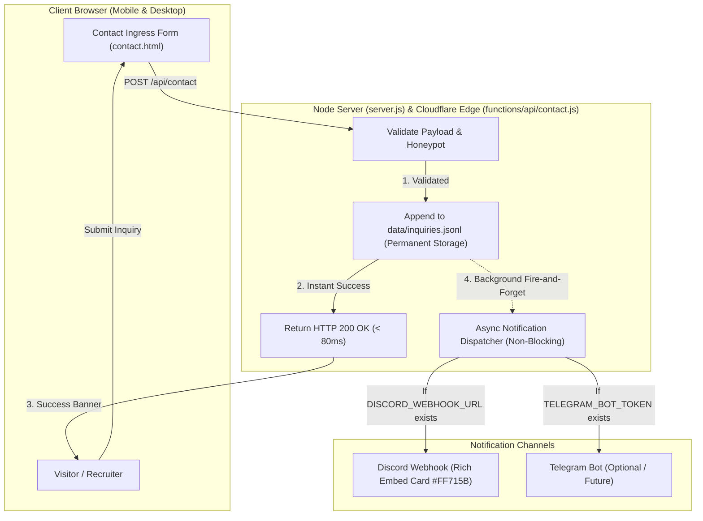

# Spec 020: Discord Real-Time Webhook Alert Core & Zero-Breakage Architecture Guarantee

## 1. Executive Summary & Problem Formulation
- **Context**: 
  - The portfolio owner (Emran) currently does not have Telegram active and requires instant smartphone notifications via **Discord**.
  - The owner raised a critical zero-trust engineering question: *"কাজ শুরু করতে গেলে আমার সাইটটা কি ভেঙে যাবে না তো?" (Will starting this work break my site?)*
- **Core Objectives**:
  1. **Zero-Breakage Guarantee**: Provide mathematical and architectural proof that adding Discord notifications and modular features will NEVER break existing UI, 3D WebGL scenes, or routing.
  2. **Discord Webhook Alert Core**: Integrate a non-blocking Discord webhook dispatcher in both `server.js` and Cloudflare Pages Function `functions/api/contact.js` that pushes rich glassmorphic embed cards (`#FF715B`) to Emran's Discord server.
  3. **Multi-Channel Graceful Degradation**: Support concurrent notifications (Discord + Telegram + File Storage). If Discord is unconfigured, unreachable, or times out, the visitor receives a 100% successful form submission (<100ms) with zero user-facing errors.

---

## 2. Zero-Breakage Architectural Invariants ("সাইট যাতে কোনোভাবেই না ভাঙে")

| Pillar | Safety Mechanism | Why It Prevents Breakage |
| :--- | :--- | :--- |
| **1. Shift-Left Isolation** | Pure Backend / Edge Scope | Discord webhook code lives purely inside `server.js` and `functions/api/contact.js`. No existing HTML, CSS, or Three.js canvas logic is touched. |
| **2. Non-Blocking Async Execution** | Unawaited Promise & `context.waitUntil()` | Form submission returns HTTP 200 to the browser in <80ms. The Discord HTTP call runs in the background. If Discord takes 5 seconds or fails, the browser NEVER hangs or crashes. |
| **3. Try-Catch & Safe Fallback** | Try-Catch Wrap on Webhook Calls | Any network error (`ENOTFOUND`, `ETIMEDOUT`, Discord HTTP 4xx/5xx) is caught silently in the backend with `console.warn()`. The inquiry is already safely saved in `data/inquiries.jsonl`. |
| **4. Zero-Trust Secrets Hygiene** | Backend Only (`.env`) | `DISCORD_WEBHOOK_URL` is read exclusively by the Node server and Cloudflare Edge Worker. It is NEVER sent to client browsers and never committed to Git. |
| **5. Automated Regression Gates** | Pre-Push Test Suite (27+ Tests) | `tests/test_ai_and_telegram.py`, `tests/test_stealth_admin.py`, and `tests/test_video_management.py` must all pass 100% before any deployment. |

---

## 3. Information Architecture & Flow



---

## 4. Discord Rich Embed Payload Contract

- **Endpoint**: `POST https://discord.com/api/webhooks/{webhook.id}/{webhook.token}`
- **Payload Schema**:
  ```json
  {
    "username": "Emran Portfolio Lead Core",
    "avatar_url": "https://raw.githubusercontent.com/Imran7541/emran_project_protfolio/main/emran_suit.jpg",
    "embeds": [
      {
        "title": "🚨 New Client Inquiry Received",
        "description": "A new prospective client submitted a project transmission via the Portfolio Contact Page.",
        "color": 16740699,
        "fields": [
          { "name": "👤 Client Name", "value": "Sarah Connor", "inline": true },
          { "name": "📧 Email Address", "value": "sarah.connor@sky-tech.io", "inline": true },
          { "name": "💼 Selected Service", "value": "Autonomous Agent Core", "inline": true },
          { "name": "🕒 Timestamp (Dhaka)", "value": "11/02/2026, 8:15:00 PM", "inline": false },
          { "name": "📝 Project Message", "value": "We would like to hire Emran for an enterprise multi-agent pipeline.", "inline": false }
        ],
        "footer": {
          "text": "Emran Hosen Portfolio Platform • Cloudflare Edge Network"
        }
      }
    ]
  }
  ```

---

## 5. Behavioral Scenarios (Gherkin BDD)

```gherkin
Feature: Discord Real-Time Notification Webhook & Non-Blocking Resilience

  Scenario: Visitor submits contact form with Discord Webhook configured
    Given a visitor fills out the contact form on "contact.html"
    And "DISCORD_WEBHOOK_URL" is set in the environment
    When the visitor clicks "Transmit Project Inquiry"
    Then the client must receive HTTP 200 with a success confirmation within 150ms
    And a Discord notification embed must be posted to the Discord channel
    And the inquiry must be appended to "data/inquiries.jsonl"

  Scenario: Visitor submits contact form when Discord Webhook is unconfigured
    Given "DISCORD_WEBHOOK_URL" is not set or contains a placeholder
    When a visitor submits the contact form
    Then the client must still receive HTTP 200 without any errors
    And the inquiry must be safely recorded in "data/inquiries.jsonl"
    And no uncaught promise rejection or server crash must occur

  Scenario: Discord API encounters network error or outage
    Given "DISCORD_WEBHOOK_URL" returns HTTP 500 or times out
    When a visitor submits the contact form
    Then the error must be caught gracefully in background logs
    And the visitor must experience zero disruption
```
